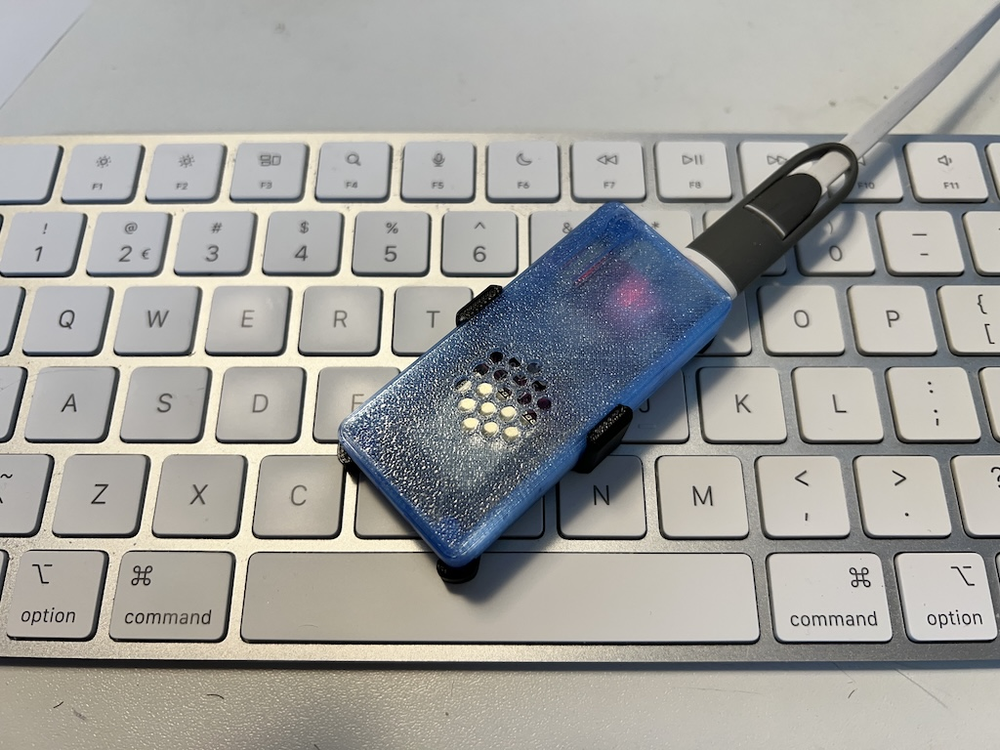
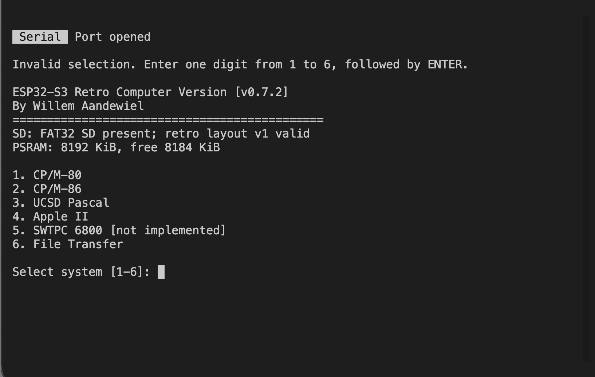
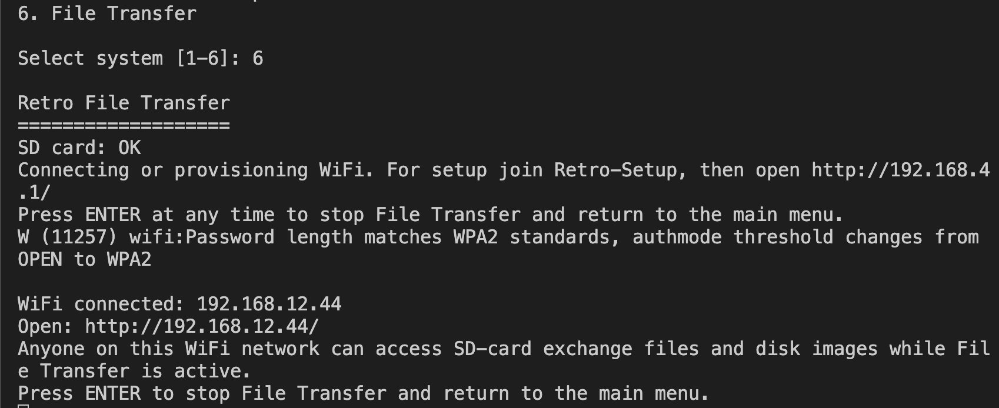
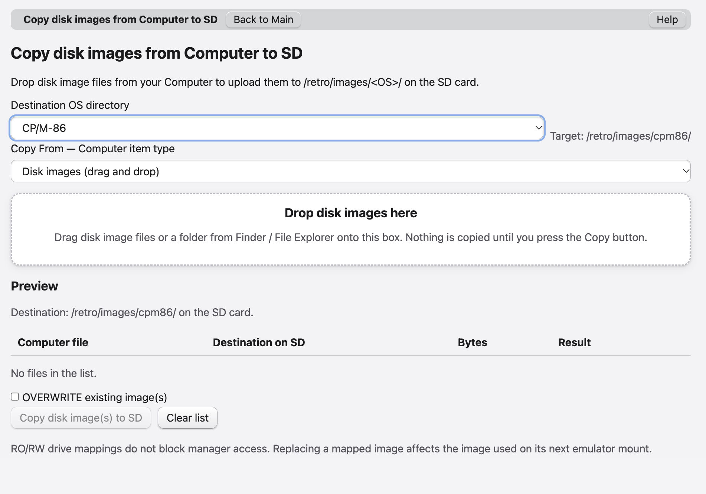

# ESP32-S3 Retro Computer

Several classic computing worlds, one small computer. ESP32-S3 Retro Computer lets you choose a retro system from a shared menu and explore its programs, languages and disk-based way of working through a USB terminal on your computer.

Revisit CP/M commands, write BASIC on an Apple II, or explore the Apple Pascal environment. Programs run inside an emulated machine, with disk-image files taking the place of physical floppy disks. The reference device is a LOLIN S3 Pro with a microSD card; your computer supplies the keyboard and terminal screen.

This emulator does not support graphics and is not suitable for playing games. It is designed for running and developing serious, text-based software, offering a hands-on way to relive the early days of personal computing and experience programming the retro way.

## Choose your system

| Menu | System | What to expect |
| --- | --- | --- |
| 1 | [CP/M-80](./assets/readMes/README_CPM80.md) | Classic CP/M 2.2 commands, utilities and compatible 8-bit software. |
| 2 | [CP/M-86](./assets/readMes/README_CPM86.md) | The 16-bit CP/M environment, with its own programs and tools. |
| 3 | [UCSD Pascal](./assets/readMes/README_UCSD.md) | Apple Pascal 1.3: a command menu, filer and Pascal programming environment. |
| 4 | [Apple II](./assets/readMes/README_APPLE2.md) | A text-focused Apple II experience with ProDOS and BASIC. |
| 5 | [SWTPC 6800](./assets/readMes/README_SWTPC.md) | Reserved for a future system; not yet available. |

The individual guides describe how closely each experience resembles its original system and where compatibility is still limited. Apple II and SWTPC are machine names rather than operating-system names; they have their own guides because they are separate choices in the menu.

## The main menu

The startup screen:

Enter a number and press Enter to start. Unavailable systems show a status beside their name, for example when required system files are missing. File Transfer needs a valid Retro SD card. Resetting the device brings you back to this menu; save your work before doing so. CP/M-86 also supports Ctrl+] to return to the menu.

Use an ANSI/VT100-compatible USB terminal, preferably with an 80-column by 24-line window. This is a keyboard-and-text-screen experience; it does not provide a modern desktop interface.

## Your programs and disks

A disk image is a file containing an entire retro disk, including its directory and programs. Each system uses its own disk formats and program types: copying a program to another system does not make it compatible.

Choose **File Transfer** to open the browser-based disk manager using the address shown in the terminal. It lets you upload and download whole disk images, browse them, copy them on the SD card, and rename or delete them. Supported CP/M, ProDOS, UCSD Pascal and DOS 3.3 images also allow you to manage the files inside a disk. Support for reading a format in the manager does not mean every emulator can boot it.

The web service behind this page is the **Disk Image Manager**, and it runs entirely on the ESP32-S3: when you select File Transfer, the device joins your Wi-Fi network, shows its address in the terminal, and serves the page itself — nothing needs to be installed on your computer. Your computer only contributes files through normal browser actions (file pickers, drag-and-drop and downloads); all disk work is done by the firmware, which streams data in small chunks so whole images and other large files are safe. Use it whenever you want to move programs in and out of a disk without any helper tooling: upload your own source files into a CP/M disk, pull a listing off a Pascal volume, copy an image to another folder on the SD card, or exchange the `drives.cfg` text file that decides which images the emulator drives use. How the web server and GUI are built — the HTTP service, the supported guest filesystems, conflict handling and recovery journals — is described in the [Disk Image Manager design](./assets/readMes/designDiskImageManager.md).

The browser offers help for each function. Press Enter in the USB console to stop File Transfer and return to the menu. Use this service on a trusted local network: it has no login and uses ordinary HTTP. 

Keep backups of valuable disks. Read-only disks protect their contents inside the emulator; the disk manager can still replace or delete mapped images after warning you. Save and finish disk activity before resetting or removing power.

## Time Source

Guest programs can ask the emulator how much real time has passed, measured in milliseconds. Each supported system exposes this monotonic millisecond counter in a way that suits its CPU: CP/M-80 and CP/M-86 read it through I/O ports, while Apple II and UCSD Pascal read it from a virtual timer card in slot 2. The included benchmark programs use it to report how long a piece of work took, and you can use it yourself to time your own programs. It is a stopwatch rather than a clock: it measures elapsed time only, with no date or time of day, and it keeps counting from the moment the device starts.

How the time source works is documented in [timeSource.md](./assets/readMes/timeSource.md): the host-side clock, the guest-visible protocol for each system, and a short example program per system showing how to read the counter, take differences and detect a missing timer.

## Included Python tools

These tools run on your computer. For everyday file transfers you can use the browser manager instead.

| Tool | What you can do with it |
| --- | --- |
| [prepareSd.py](tools/prepareSd.py) | Prepare the Retro folders on an already formatted, mounted SD card. It does not format the card or supply disks. |
| [diskManager.py](tools/diskManager.py) | The one disk command line: `--type SYSTEMDSK` builds the bootable system disk for the firmware (a firmware update is needed before the device uses it), `--type WORKDSK` creates an empty work disk for the SD card. Every writing run shows a summary and asks `Are you sure (y/N)` (skip with `--yes`); `--type` also accepts unique abbreviations (`SYS`, `WORK`, …). |
| [extractFiles.py](tools/extractFiles.py) | Browse and manage files in existing images. It offers interactive menus for CP/M, Apple II and UCSD Pascal; CP/M and UCSD also support direct add, extract and remove actions. SWTPC is not implemented. |

The OS-specific folders under [tools/](tools/) contain the matching disk builders and file-browser helpers. [extractApple2Files.py](tools/apple2/extractApple2Files.py) is also available as a dedicated interactive Apple disk browser. The `*HardwareTest.py` tools for CP/M-80, CP/M-86, Apple II and UCSD Pascal check a connected device, while [transferTest.py](tools/transferTest.py) checks browser-service transfers. These checks create test files and are for deliberate testing, not normal use.

Other Python helpers generate emulator resources, support BASIC conversion and disk formats, build sample programs or maintain project files. They are supporting tools rather than applications you need to start the computer. See [the tools guide](tools/README.md) for detailed usage; availability depends on the selected system and the system resources you provide.

## Further reading

This README and the system guides focus on using and exploring the computer. Build instructions, wiring and implementation details belong in the existing [tools guide](tools/README.md) and system design notes: [CP/M-80](designCPM80.md), [CP/M-86](designCPM86.md), [UCSD Pascal](designUCSD.md), [Apple II](designApple2.md) and [SWTPC](designSWTPC.md).
