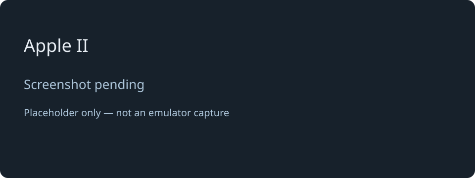

# Apple II

[← Back to the main README](README.md)

## What is it?

Choose **4** to explore a text-focused Apple II with ProDOS and BASIC. List the files on a volume, load compatible programs, and write or run BASIC programs using your USB terminal.

The supplied ProDOS system disk starts BASIC. Try `PRINT 2+3` at the `]` prompt, or `CATALOG` to explore a disk. The original Apple II profile supports 40-column text and an 80-column expansion-card mode; `PR#0` and `PR#3` select those text outputs.

## How faithful is the experience?

Apple software runs on an emulated 6502 with Apple memory, keyboard and disk behaviour. This preserves much of the text-programming experience, including BASIC and disk access. The 80-column expansion uses a compatible interface with project-written firmware; it is not a complete reproduction of an original card.

The display is rendered as terminal text. Graphics are not rendered, and games or programs needing graphics, special keys, unusual peripherals or protected disk formats should not be assumed compatible. The supplied experience centres on ProDOS; disk-manager support for DOS 3.3 files does not guarantee DOS 3.3 software compatibility.

The recorded device run of 24 October 2026 reports 29 checks passed and one failed. Boot, BASIC arithmetic and several disk read/write and persistence checks passed. The read-only system disk's reported free-space check failed, although the attempted file was not created; that remains an unresolved test result. A larger BASIC workflow and special-key behaviour still require manual checks. This is a useful text environment with known limits, not complete Apple II compatibility.

## Screen preview

*Screenshot pending: this is a labelled placeholder, not an emulator capture.*

[← Back to the main README](README.md)
