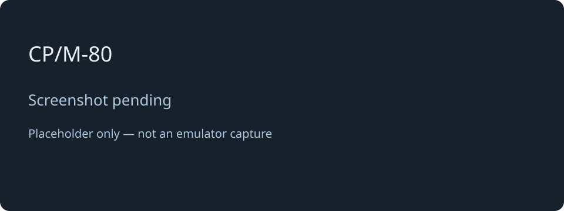

# CP/M-80

[← Back to the main README](README.md)

## What is it?

CP/M-80 brings the CP/M 2.2 command-line world to the device. Choose **1** in the main menu to reach the familiar `A>` prompt. Explore disk directories, run compatible `.COM` programs and work with the utilities or languages available on your images.

Try `DIR` to see the current disk's files. Programs and work disks are selected with drive letters; available drives depend on the disks supplied with your setup.

## How faithful is the experience?

The emulator runs genuine CP/M command-processor and operating-system code on an emulated Z80, so this is more than an imitation of the prompt. It recreates the program-and-disk workflow of a CP/M computer, rather than one particular manufacturer's complete hardware.

The recorded device run of 31 October 2026 reports 48 checks passed and none failed, including disk and command workflows. Full-screen terminal behaviour and a complete editor/compiler workflow were left for manual checks. Software that needs specific peripheral hardware or exact original timing may behave differently; compatibility with every CP/M application is not established.

## Screen preview

*Screenshot pending: this is a labelled placeholder, not an emulator capture.*

[← Back to the main README](README.md)
