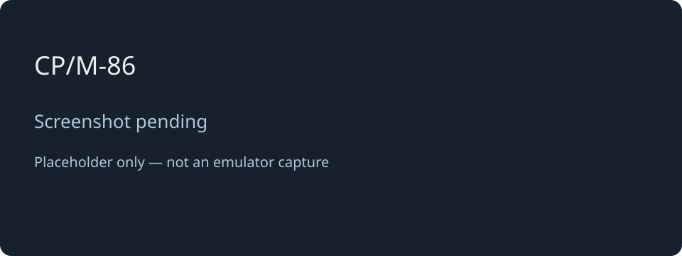

# CP/M-86

[← Back to the main README](README.md)

## What is it?

CP/M-86 is the 16-bit member of the CP/M family. Choose **2** in the main menu to start its command-line environment. Use `DIR` to explore the disk and run compatible `.CMD` programs, including the utilities supplied with your system image.

It has a familiar CP/M style, but CP/M-80 `.COM` programs are not interchangeable with CP/M-86 programs. Press **Ctrl+]** to return to the main menu when you have finished disk activity.

## How faithful is the experience?

The system executes CP/M-86 on an emulated 8086 with its own disk and console support. It aims to preserve the CP/M-86 software experience, rather than recreate an IBM PC. DOS, PC graphics, specialised PC peripherals and exact historical timing are outside that experience.

The recorded device run of 1 November 2026 reports 59 checks passed and none failed, including return-to-menu and relaunch checks. Full-screen terminal escape sequences still need manual verification. These results establish tested workflows, not universal application compatibility or original-machine speed.

## Screen preview

*Screenshot pending: this is a labelled placeholder, not an emulator capture.*

[← Back to the main README](README.md)
