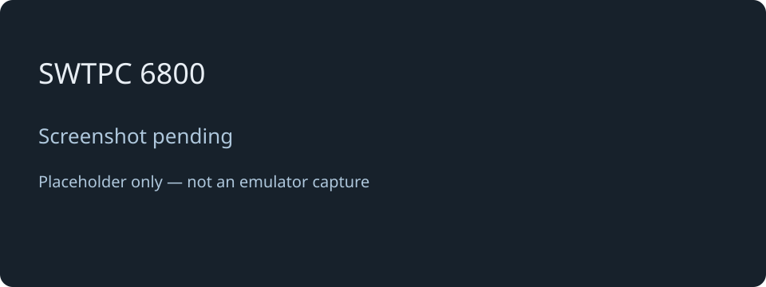

# SWTPC 6800

[← Back to the main README](README.md)

## What is it?

The SWTPC 6800 entry reserves a place for a future Motorola 6800-based retro-computer experience. It appears as **5** in the main menu, but cannot start a working system yet.

There is no usable operating system or program environment behind this selection today. Choose one of the other four profiles to explore a running system.

## How faithful is the experience?

No working SWTPC emulator or operating-system profile has been implemented, so there is currently no emulation fidelity to assess. A specific OS, supported software and expected hardware behaviour have not yet been established. The SWTPC entries in the disk tools and browser manager are placeholders too.

## Screen preview

*Screenshot pending: this is a labelled placeholder, not an emulator capture.*

[← Back to the main README](README.md)
