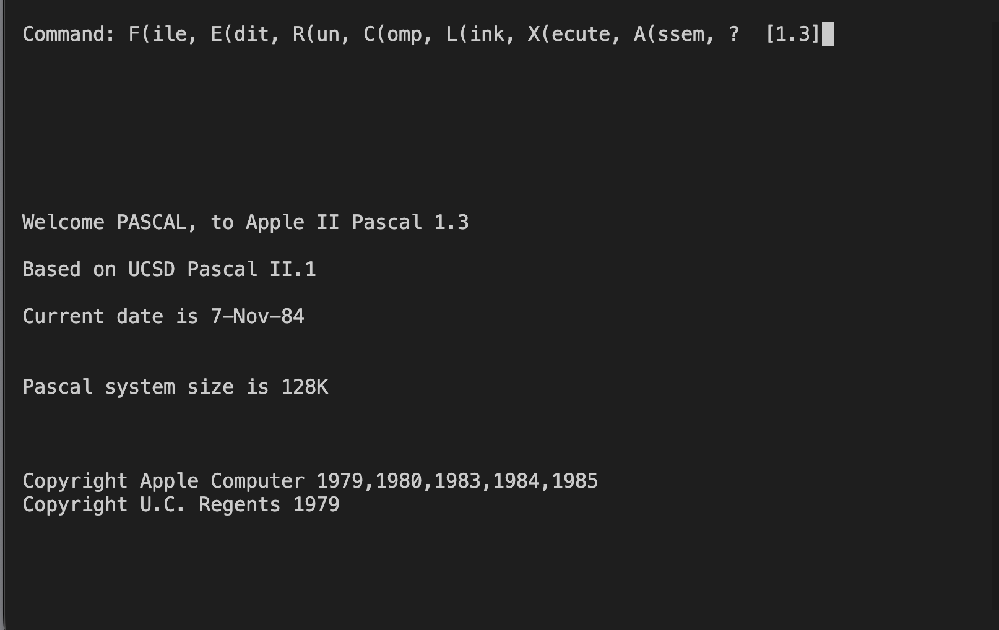
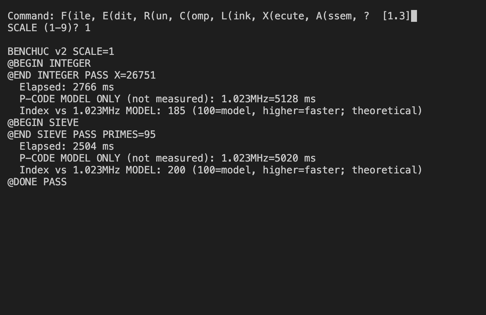
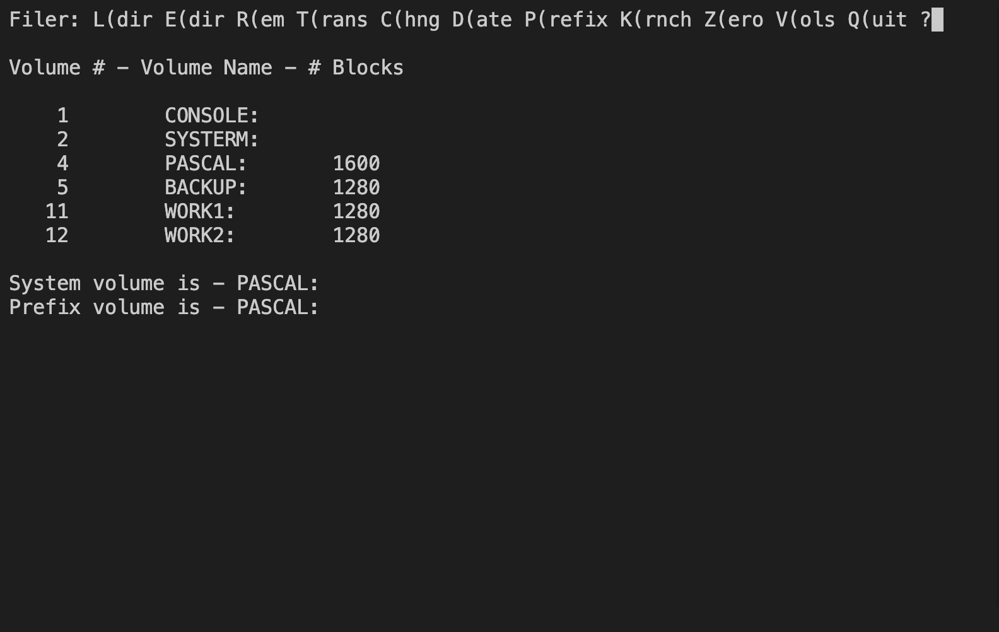

# UCSD Pascal

[← Back to the main README](../../README.md)

## What is it?

Choose **3** in the System Menu for Apple Pascal 1.3, the Apple version of the UCSD Pascal environment. Its command menu brings together a filer, editor, compiler and program runner. It is a place to explore Pascal and the structured, disk-based programming workflow of the period.

At the command menu, **F** opens the Filer and **V** lists online volumes. The supplied profile names the system and backup volumes `PASCAL:` and `BACKUP:`, with `WORK1:` and `WORK2:` for work; the actual contents depend on your images.

## How faithful is the experience?

This profile runs Apple Pascal inside the shared Apple II emulator, using an Apple IIe profile. The menus and disk operations come from the running Pascal system, rather than a rewritten host application. It is a separate disk-and-machine setup from menu option 4.

## Screen preview

[← Back to the main README](../../README.md)
