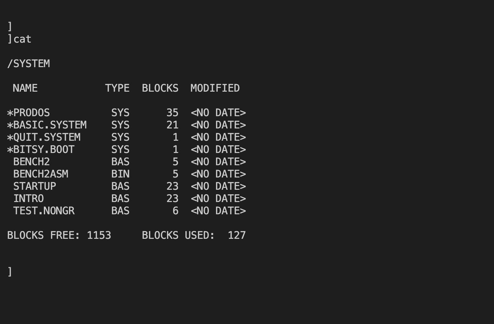
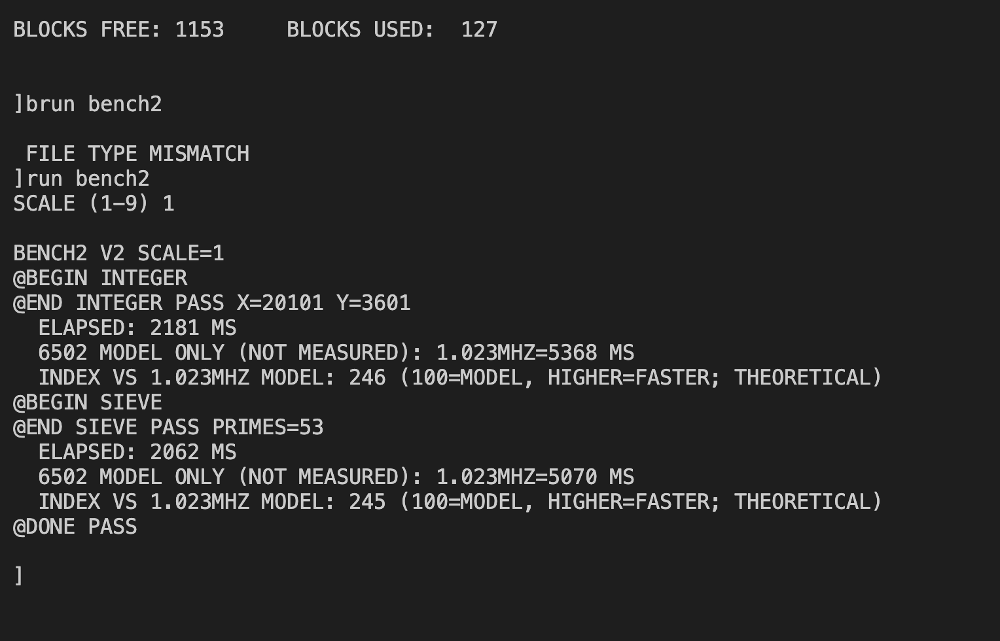
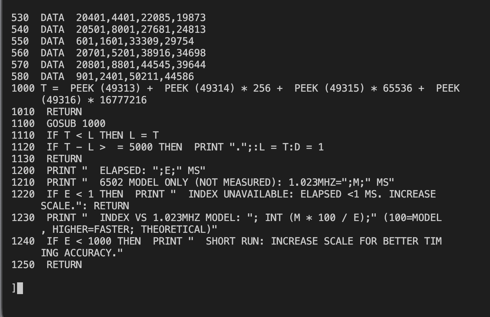
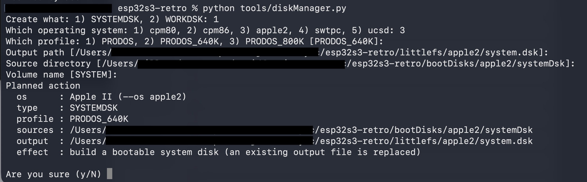

# Apple II

[← Back to the main README](../../README.md)

## What is it?

Choose **4** in the System Menu to explore a text-focused Apple II with ProDOS and BASIC. List the files on a volume, load compatible programs, and write or run BASIC programs using your USB terminal.

The supplied ProDOS system disk starts BASIC. Try `PRINT 2+3` at the `]` prompt, or `CATALOG` to explore a disk. The original Apple II profile supports 40-column text and an 80-column expansion-card mode; `PR#0` and `PR#3` select those text outputs.

## How faithful is the experience?

Apple software runs on an emulated 6502 with Apple memory, keyboard and disk behaviour. This preserves much of the text-programming experience, including BASIC and disk access. The 80-column expansion uses a compatible interface with project-written firmware; it is not a complete reproduction of an original card.

The display is rendered as terminal text. Graphics are not rendered, and games or programs needing graphics, special keys, unusual peripherals or protected disk formats should not be assumed compatible. The supplied experience centres on ProDOS; disk-manager support for DOS 3.3 files does not guarantee DOS 3.3 software compatibility.

## Screen preview

<div align="center">

</div>

<div align="center">

</div>

<div align="center">

</div>


## Creating a disk

Disks for the Apple II are made on your computer with the host tool `tools/diskManager.py`. It builds two kinds of ProDOS image:

- **System disk** (`--type SYSTEMDSK`): the bootable ProDOS volume stored inside the firmware (`littlefs/apple2/system.dsk`). It copies the bootable base volume `bootDisks/apple2/prodosEmpty.po` (volume `/SYSTEM`: `PRODOS`, `BASIC.SYSTEM`, `QUIT.SYSTEM`, `BITSY.BOOT`) and adds every file in `bootDisks/apple2/systemDsk/`. Choose the profile that matches the `SD6.1` line of `littlefs/apple2/drives.cfg`. Because this disk is part of the firmware, run `idf.py build` and flash again after building it.
- **Work disk** (`--type WORKDSK`): an empty ProDOS data volume (`.po`) written to `sdcard/retro/images/apple2/`. Its volume name follows the image file name. Upload it to the SD card with File Transfer (menu option **6**) into `/retro/images/apple2/` and give its drive a line in `littlefs/apple2/drives.cfg`, for example `SD6.2=/retro/images/apple2/DATA800.po,RW,APPLE2_800K`.

```sh
python3 tools/diskManager.py --type SYSTEMDSK --os apple2 --profile PRODOS_640K
python3 tools/diskManager.py --type WORKDSK --os apple2 --profile 800K DATA800.po
```

System-disk profiles are `PRODOS` (140K), `PRODOS_640K` and `PRODOS_800K`; work-disk profiles are `140K`, `640K` and `800K` (default `800K`). In a terminal every option you leave out is asked for and ENTER accepts the offered default; the Apple II run also asks for the system volume name (default `/SYSTEM`). Each run first shows a "Planned action" summary and asks `Are you sure (y/N)`. Put programs and files into a volume with `tools/extractFiles.py --os apple2` (interactive menu; `.BAS`, `.TXT`, `.BIN` and `.SYS` files). To lists all options type:
```sh
python3 tools/diskManager.py --help
```

<div align="center">

</div>


## Design documentation

The complete technical design of this machine lives in the project root as [designApple2.md](../../designApple2.md). It describes the emulated 6502 motherboard, memory, keyboard and Disk II storage, the Language Card, the 80-column text card and the tests that prove the implementation. It is meant for anyone who wants to understand or extend the firmware; you do not need it to use the Apple II.

---
[← Back to the main README](../../README.md)
