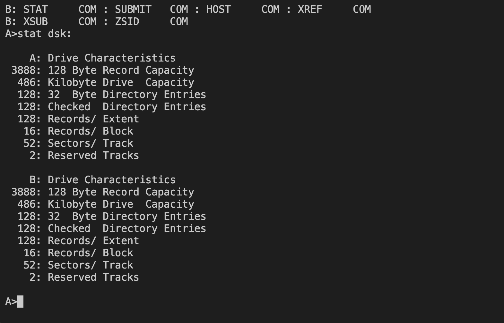
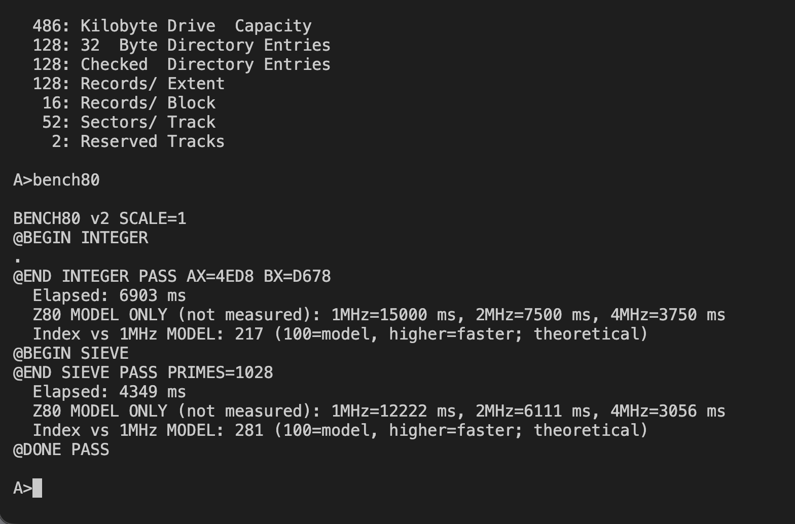
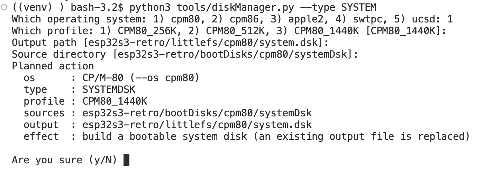

# CP/M-80

[← Back to the main README](../../README.md)

## What is it?

CP/M-80 brings the CP/M 2.2 command-line world to the device. Choose **1** in the System Menu to reach the familiar `A>` prompt. Explore disk directories, run compatible `.COM` programs and work with the utilities or languages available on your images.

Try `DIR` to see the current disk's files. Programs and work disks are selected with drive letters; available drives depend on the disks supplied with your setup.

## How faithful is the experience?

The emulator runs genuine CP/M command-processor and operating-system code on an emulated Z80, so this is more than an imitation of the prompt. It recreates the program-and-disk workflow of a CP/M computer, rather than one particular manufacturer's complete hardware.
## Screen preview

<div align="center">

</div>

<div align="center">

</div>


## Creating a disk

Disks for CP/M-80 are made on your computer with the host tool `tools/diskManager.py`. It builds two kinds of image:

- **System disk** (`--type SYSTEMDSK`): the bootable `A:` disk stored inside the firmware (`littlefs/cpm80/system.dsk`). It is composed from the CP/M-80 boot resources plus every file in `bootDisks/cpm80/systemDsk/`. Choose the profile that matches the `A=` line of `littlefs/cpm80/drives.cfg`; the firmware refuses a system disk whose size does not match. Because this disk is part of the firmware, run `idf.py build` and flash again after building it.
- **Work disk** (`--type WORKDSK`): an empty data disk written to `sdcard/retro/images/cpm80/`. Upload it to the SD card with File Transfer (menu option **6**) into `/retro/images/cpm80/` and give its drive a line in `littlefs/cpm80/drives.cfg`.

```sh
python3 tools/diskManager.py --type SYSTEMDSK --os cpm80 --profile CPM80_1440K
python3 tools/diskManager.py --type WORKDSK --os cpm80 --profile CPM80_512K work.dsk
```

The profiles are `CPM80_256K`, `CPM80_512K` and `CPM80_1440K`; work disks also accept `CPM80_8M`. In a terminal every option you leave out is asked for and ENTER accepts the offered default; each run first shows a "Planned action" summary and asks `Are you sure (y/N)`. Put programs and files into an image with `tools/extractFiles.py --os cpm80`; files need CP/M 8.3 names. To lists all options type:

```sh
tools/diskManager.py --help
```
<div align="center">

</div>


[← Back to the main README](../../README.md)
