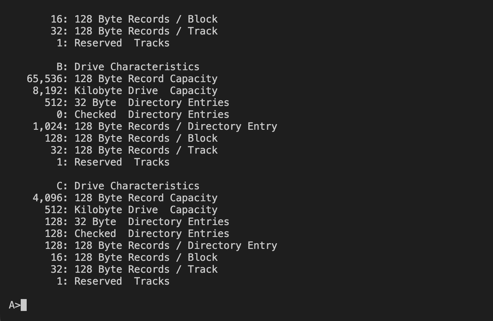
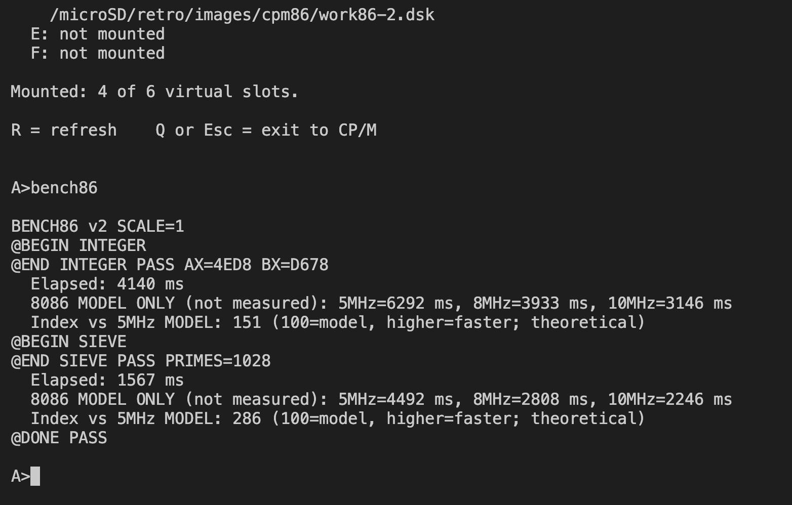
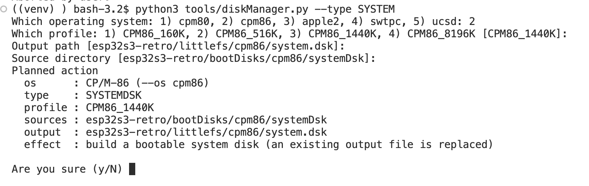

# CP/M-86

[← Back to the main README](../../README.md)

## What is it?

CP/M-86 is the 16-bit member of the CP/M family. Choose **2** in the main menu to start its command-line environment. Use `DIR` to explore the disk and run compatible `.CMD` programs, including the utilities supplied with your system image.

It has a familiar CP/M style, but CP/M-80 `.COM` programs are not interchangeable with CP/M-86 programs. Press **Ctrl+]** to return to the System Menu when you have finished disk activity.

## How faithful is the experience?

The system executes CP/M-86 on an emulated 8086 with its own disk and console support. It aims to preserve the CP/M-86 software experience, rather than recreate an IBM PC. DOS, PC graphics, specialised PC peripherals and exact historical timing are outside that experience.

## Screen preview

<div align="center">

</div>

<div align="center">

</div>


## Creating a disk

Disks for CP/M-86 are made on your computer with the host tool `tools/diskManager.py`. It builds two kinds of image:

- **System disk** (`--type SYSTEMDSK`): the bootable `A:` disk stored inside the firmware (`littlefs/cpm86/system.dsk`). It is composed from the CP/M-86 boot resources plus every file in `bootDisks/cpm86/systemDsk/`. Choose the profile that matches the `A=` line of `littlefs/cpm86/drives.cfg`; the firmware refuses a system disk whose size does not match. The kernel `cpm.sys` and the BIOS overlay `retro86bios.h86` stay outside `A:` in `littlefs/cpm86/` — keep them in place. Because the system disk is part of the firmware, run `idf.py build` and flash again after building it.
- **Work disk** (`--type WORKDSK`): an empty data disk written to `sdcard/retro/images/cpm86/`. Upload it to the SD card with File Transfer (menu option **6**) into `/retro/images/cpm86/` and give its drive a line in `littlefs/cpm86/drives.cfg` (drives `B:` through `F:` are SD images).

```sh
python3 tools/diskManager.py --type SYSTEMDSK --os cpm86 --profile CPM86_1440K
python3 tools/diskManager.py --type WORKDSK --os cpm86 --profile CPM86_160K work86.dsk
```

The profiles are `CPM86_160K`, `CPM86_516K`, `CPM86_1440K` and `CPM86_8196K`, and the drives.cfg identifier of a drive must equal the profile of its image. In a terminal every option you leave out is asked for and ENTER accepts the offered default; each run first shows a "Planned action" summary and asks `Are you sure (y/N)`. Put programs and files into an image with `tools/extractFiles.py --os cpm86`; files need CP/M 8.3 names. To lists all options type:
```sh
python3 tools/diskManager.py --help
```

<div align="center">

</div>


## Design documentation

The complete technical design of this system lives in the project root as [designCPM86.md](../../designCPM86.md). It describes the project-owned 8086 CPU core, the guest-visible hardware, the boot system and load addresses, the guest BIOS, the virtual I/O port contract, the disk formats and drive configuration, and the tests that prove the implementation. It is meant for anyone who wants to understand or extend the firmware; you do not need it to use CP/M-86.

---
[← Back to the main README](../../README.md)
