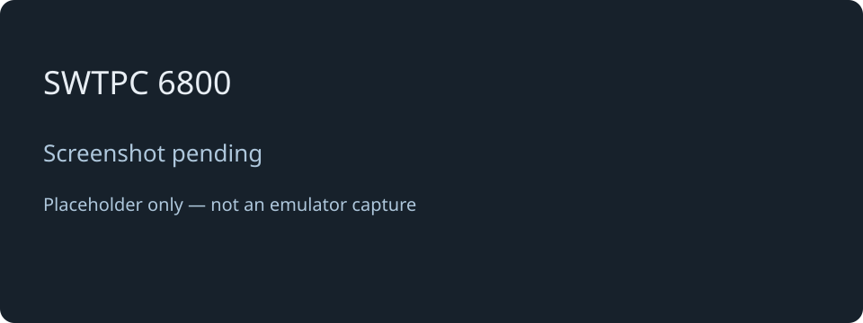

# SWTPC 6800

[← Back to the main README](../../README.md)

## What is it?

The SWTPC 6800 entry reserves a place for a future Motorola 6800-based retro-computer experience. It appears as **5** in the System Menu, but cannot start a working system yet.

There is no usable operating system or program environment behind this selection today. Choose one of the other four profiles to explore a running system.

## How faithful is the experience?

No working SWTPC emulator or operating-system profile has been implemented, so there is currently no emulation fidelity to assess. A specific OS, supported software and expected hardware behaviour have not yet been established. The SWTPC entries in the disk tools and browser manager are placeholders too.

## Creating a disk

The host tool `tools/diskManager.py` builds the system and work disks of the other systems, but it cannot create an SWTPC 6800 disk yet: the system is registered as planned and `--os swtpc` is refused until an operating system and a disk-image format have been established. There is therefore no disk to prepare for this system today, and no screenshot to show.

## Screen preview

*Screenshot pending: this is a labelled placeholder, not an emulator capture.*

[← Back to the main README](../../README.md)
