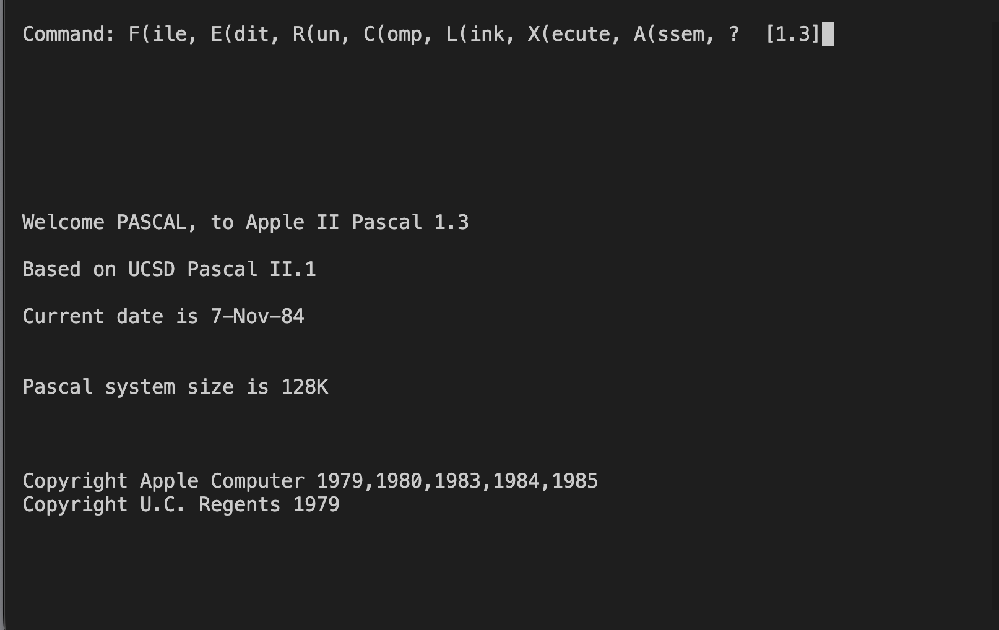
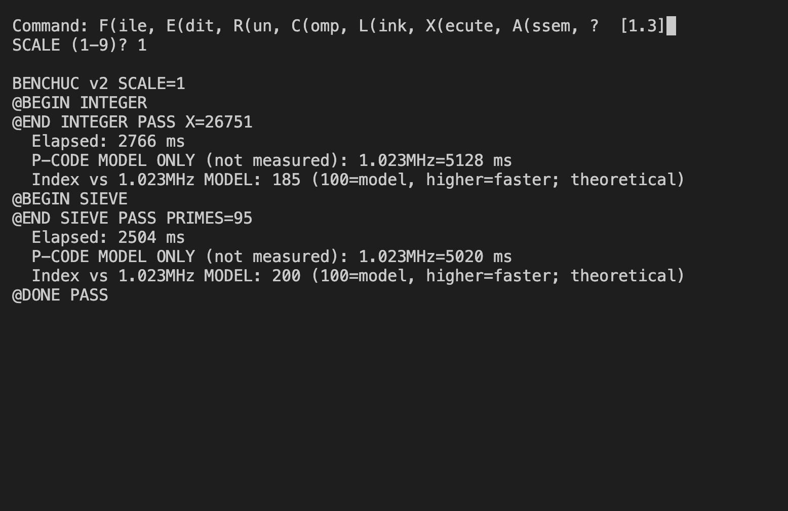
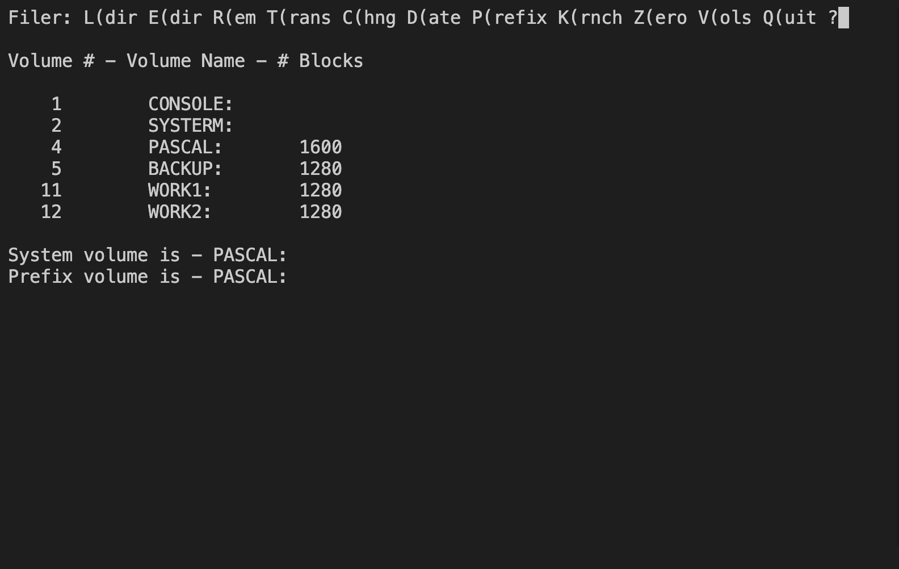
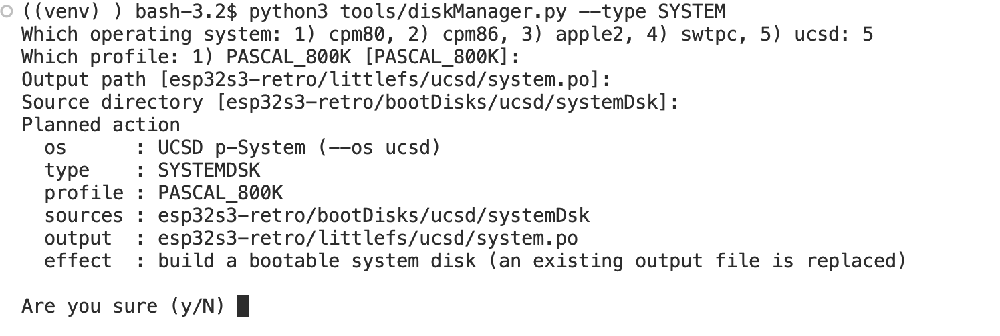

# UCSD Pascal

[← Back to the main README](../../README.md)

## What is it?

Choose **3** in the System Menu for Apple Pascal 1.3, the Apple version of the UCSD Pascal environment. Its command menu brings together a filer, editor, compiler and program runner. It is a place to explore Pascal and the structured, disk-based programming workflow of the period.

At the command menu, **F** opens the Filer and **V** lists online volumes. The supplied profile names the system and backup volumes `PASCAL:` and `BACKUP:`, with `WORK1:` and `WORK2:` for work; the actual contents depend on your images.

## How faithful is the experience?

This profile runs Apple Pascal inside the shared Apple II emulator, using an Apple IIe profile. The menus and disk operations come from the running Pascal system, rather than a rewritten host application. It is a separate disk-and-machine setup from menu option 4.

## Screen preview

<div align="center">

</div>

<div align="center">

</div>

<div align="center">

</div>


## Creating a disk

Disks for UCSD Pascal are made on your computer with the host tool `tools/diskManager.py`. It builds two kinds of Pascal volume (`.po` files):

- **System disk** (`--type SYSTEMDSK`): the bootable Pascal system disk stored inside the firmware (`littlefs/ucsd/system.po`). It copies the Apple Pascal 1.3 base volume and adds every file in `bootDisks/ucsd/systemDsk/` (`128K.APPLE`/`128K.PASCAL` are placed as `SYSTEM.APPLE`/`SYSTEM.PASCAL`). The only profile is `PASCAL_800K`, which matches the mounted system disk. Because this disk is part of the firmware, run `idf.py build` and flash again after building it.
- **Work disk** (`--type WORKDSK`): an empty, formatted Pascal work volume written to `sdcard/retro/images/ucsd/`. Its volume name follows the image file name. Upload it to the SD card with File Transfer (menu option **6**) into `/retro/images/ucsd/` and mount it on a free drive in `littlefs/ucsd/drives.cfg` (the supplied profile uses `WORK1:` and `WORK2:` for work volumes).

```sh
python3 tools/diskManager.py --type SYSTEMDSK --os ucsd --profile PASCAL_800K
python3 tools/diskManager.py --type WORKDSK --os ucsd --profile 140K work.po
```

Work-disk profiles are `640K` (default) and `140K`. In a terminal every option you leave out is asked for and ENTER accepts the offered default; each run first shows a "Planned action" summary and asks `Are you sure (y/N)`. Put programs and files into a volume with `tools/extractFiles.py --os ucsd` (the file kind follows the suffix: `.TEXT`, `.CODE`, `.DATA`). To lists all options type:
```sh
python3 tools/diskManager.py --help
```

<div align="center">

</div>


## Design documentation

The engineering design behind this profile lives in the project root as [designUCSD.md](../../designUCSD.md). It describes how Apple Pascal 1.3 runs on the shared Apple II emulator, how the disk and volume profile is configured, and which results have been verified so far. It is meant for anyone who wants to understand or extend the firmware; you do not need it to explore Pascal.

---
[← Back to the main README](../../README.md)
